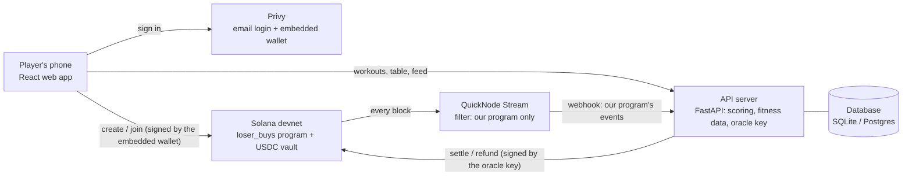

# Loser Buys

**Out-move your friends. Winner takes the pool.**

University Blockchain Conference Hackathon 2026. Track: Consumer Applications. Chain award: Solana. Bounties: QuickNode Streams, Gemini Prediction Markets.
Team: Yusuf Elloumi, Shaan Bhasin, Rohan Bhasin, Mahdi Khani.

A friend group starts a fitness challenge. Each person chips in a buy-in, workouts earn points, and at the end the pool is paid to whoever is top of the table. The pool is held and paid out by a program on Solana, so no friend has to hold the money and nobody can run off with it.

**Demo only: Solana devnet and test tokens. No real money.**

| | |
|---|---|
| Live app | Not deployed yet |
| Demo video | Not recorded yet |
| Program ID (devnet) | [`FeCj36zk7YNkdfKZXjfjSmftqpJv9C68uBNSvtRt3ssC`](https://explorer.solana.com/address/FeCj36zk7YNkdfKZXjfjSmftqpJv9C68uBNSvtRt3ssC?cluster=devnet) |

## What using it looks like

1. Sign in with an email code. There is no wallet to install, no seed phrase, and no fee to think about.
2. Tap "Add test funds" (this stands in for paying by card).
3. Start a challenge: name it, pick a buy-in, how long friends can join, and how long it runs. Share the invite link.
4. Friends open the link, agree to share their points with the group, and tap "Join for 1 USDC".
5. Log workouts. The league table shows each player's points and which days they were active.
6. When time is up, the program pays the pool to the top scorer. Ties split it. If fewer than two people joined, everyone is refunded.

Scoring ("Daily Mover"): 1 point for a day with at least 20 active minutes, plus 1 point for every 5 km that day, capped at 3 points a day.

## How it works



Three pieces are ours:

- **The pool program** (`onchain/`, Rust + Anchor). Holds each challenge's buy-ins in a token vault that only the program can spend from, and pays them out.
- **The API server** (`api/`, Python + FastAPI). Turns workouts into points, stores the league table, receives onchain events from the Stream, and holds the one key allowed to report results.
- **The web app** (`web/`, React + Vite + TypeScript). Everything the player sees.

Glossary for the crypto words used below:

- **Devnet**: Solana's free test network. Tokens there have no value.
- **USDC**: a token worth one dollar each. We use Circle's devnet test version.
- **Program**: Solana's name for a smart contract, code that runs on the blockchain.
- **Embedded wallet**: a wallet created for the user behind the scenes when they sign in, so they never handle keys.
- **Oracle**: a trusted reporter that brings outside facts (here, who won) onto the blockchain.

## How we use Solana

| Item | Value |
|---|---|
| Program ID (devnet) | `FeCj36zk7YNkdfKZXjfjSmftqpJv9C68uBNSvtRt3ssC` |
| Framework | Anchor 1.2.2 (Rust) |
| Token | Circle devnet USDC, an SPL token: `4zMMC9srt5Ri5X14GAgXhaHii3GnPAEERYPJgZJDncDU` |
| Source | `onchain/programs/loser_buys/` |
| Interface (IDL) | `onchain/idl/loser_buys.json` |

All the money logic is onchain. The server never holds player funds.

| Instruction | Who can call | What it does |
|---|---|---|
| `create_challenge` | Anyone | Creates a challenge, its empty vault and its **Rules** account. Stores the buy-in, token, start and end times, the oracle's address, and locks the rules hash, payout terms and verifier key |
| `join_challenge(expected_rules_hash)` | Any player, before the start time | Fails unless `expected_rules_hash` equals the locked hash. Moves the buy-in into the vault and adds the player (up to 8) |
| `end_early` | Oracle only | Ends the challenge now. Used by the admin "End week now" button |
| `settle` | Oracle only, after the end time | Equal split (winner takes all, goal, teams, ties). Requires the verifier's Ed25519-signed result as the instruction just before it; pays exactly the winners and shares in that result |
| `settle_split(tie_groups)` | Oracle only, after the end time | Podium payouts. The oracle only orders the winners; the program works out each share from the locked split and refuses anything else |
| `refund` | Anyone | Returns every buy-in if fewer than 2 players joined by the start, or if nobody settled within 72 hours of the end |

Each instruction emits an event (`RulesLocked`, `ChallengeCreated`, `PlayerJoined`, `ChallengeEnded`, `ChallengeSettled`, `ChallengeRefunded`). Those events are what the QuickNode Stream delivers to our server.

### Locked rules: what Solana enforces, not just records

Once anyone has paid, the rules and the payout split cannot change, and the program enforces them.

1. **Rules locked at creation.** The server turns the creator's choices into a canonical JSON ruleset (`api/rules.py`: scoring rules version and fingerprint, length, player cap, which workouts count, consent, format, payout terms, prediction rounds, verifier). Its SHA-256 goes into a `Rules` account (a PDA at seeds `["rules", challenge]`) that no instruction can write again. The payout terms are stored as values: a kind (winner takes all, podium, goal, teams) and, for a podium, the split in basis points (10,000 = 100%), checked at creation to be 2-3 places, highest first, adding to 100%.
2. **Joining quotes the rules.** The browser hashes the ruleset text it shows the player (WebCrypto, not the server's word) and passes that hash to `join_challenge`. Any other hash fails with `RulesMismatch` before money moves. If our scoring code changes version later, the server refuses to settle under the new rules; the challenge is refunded instead.
3. **Result signed → signature checked by Solana at payout.** A separate verifier key signs the result. The payout transaction carries two instructions: Solana's built-in Ed25519 program checks the signature, then our `settle`/`settle_split` reads that check through the instructions sysvar and refuses unless it was the instruction right before it, signed by the locked verifier key, over a message naming this program, this challenge and the locked rules hash. Winners, shares and the score-sheet hash are read from the signed message itself. For a podium the program also recomputes every share from the locked split; for equal formats it requires equal shares.

Message layout (v2): `"rival.proof-of-effort.v2"` (24 bytes) | program ID | challenge | rules hash | score-sheet hash (32 bytes each) | winner count (1 byte) | winners (32 bytes each) | shares (u16 little-endian basis points each). Details in [`docs/ARCHITECTURE.md`](docs/ARCHITECTURE.md#4-results-settlement-and-trust). One byte fixture (`onchain/shared/proof_v2_fixture.json`) is checked by the Python tests, the program tests and the TypeScript builder.

On screen: "Payout locked onchain: 60 / 30 / 10. Not even Rival can change it." and, after payout, "Rules locked at creation → result signed → signature checked by Solana at payout", with a link to the payout on Solana Explorer.

Challenges created before Nov 19 have no `Rules` account. The upgraded program cannot settle them; they are refund-only (anyone can refund 72 hours after the end).

**How crypto stays invisible.** Privy creates a Solana wallet when someone signs in with their email. Wallet popups are turned off; our own button says what will happen ("Join for 1 USDC"). The server quietly sends each new wallet a little devnet SOL for fees, so players never see a fee. Amounts are shown in dollars, and addresses appear only behind "details" links to Solana Explorer.

**Verified on devnet through the web app (Nov 14):**

| Case | Challenge | Result |
|---|---|---|
| Single winner | [`6xr7yYYL...TdsLt`](https://explorer.solana.com/address/6xr7yYYLKur31ZBnf4NnD7YrDVJoxYWax9zp6TiTdsLt?cluster=devnet) | Winner received the whole 2 USDC pool ([transaction](https://explorer.solana.com/tx/5f8z9XGtuQKUT8k2bwm3Cv8L45C4SACt3w4brSVS7jLU8XABhRcdtGdpXUSGwVDwENU8M37WGHXog7NJSYg1xhrL?cluster=devnet)) |
| Tie | [`9fXUkUsz...oRGep`](https://explorer.solana.com/address/9fXUkUszcHksGWTmDNht32cKSNCYRKXK3kEqDvcoRGep?cluster=devnet) | Both players received 1 USDC |
| Refund | [`JMjBkJYw...9Y2WD`](https://explorer.solana.com/address/JMjBkJYw2mopKmVdKHYacpoQa52jwfaCTxmb8j9Y2WD?cluster=devnet) | The only player got the buy-in back ([transaction](https://explorer.solana.com/tx/36dy95sK6bqvFBDP1jTbejNbSaZ4uuY3nARjj5at2KR1nELXCs9qeK4EUpzKr6fvywAy775MCHnfwytiLH74kPyU?cluster=devnet)) |

## How we use QuickNode Streams

Our server does not poll the blockchain to find out what happened. A QuickNode Stream pushes it.

| Setting | Value |
|---|---|
| Network | Solana Devnet |
| Dataset | Programs + Logs |
| Filter | `streams/filter.js` |
| Destination | Webhook: `POST /webhooks/quicknode` on our API |

**Filter logic.** Out of every transaction on devnet, the filter keeps only successful ones that invoked our program ID. For each it sends just the signature, slot, block time, and log lines. If a batch has nothing for us it returns `null`, and nothing is delivered. Test it locally with `node streams/test_filter.js`.

**What the server does with a delivery** (`api/events.py`):

1. Checks the HMAC-SHA256 signature made with the Stream's security token (headers `X-QN-Nonce`, `X-QN-Timestamp`, `X-QN-Signature`) and refuses old deliveries.
2. Decodes our program's events from the log lines using the program's IDL.
3. Stores them in `chain_events`, skipping any it already has, so a repeated delivery is harmless.
4. Updates the stored challenge when it ends, settles, or is refunded.

**Why Streams is a core data source.** Three things on the challenge screen come from Stream events:

- **"Deposit confirmed"** appears when the player's `PlayerJoined` event has been stored, not when the browser thinks the transaction went through.
- **The feed** ("Maya joined - pool is now 3 USDC", "Settled - Sam won 4 USDC") is built from the stored events.
- **The pool total** is re-read whenever a new event arrives, so every player's screen updates when anyone joins or the pool is paid out.

**Why Streams rather than polling.** The public devnet RPC rate-limits heavily, and polling would mean asking "anything new?" for every open challenge every few seconds. With a filtered Stream the server hears only about our program, within seconds, and does no work when nothing happens.

**One honest limit.** A Solana Stream cannot replay blocks it failed to deliver, and it pauses after repeated failures (for example when our server is off). So after each settlement or refund the server runs a small catch-up (`events.catch_up`) that fetches that challenge's recent transactions and stores any missed events through the same code path. The Stream is the normal source; the catch-up only fills gaps.

## How we use Gemini Prediction Markets

**Prediction rounds.** Each challenge can run free prediction picks next to the main contest. When creating it, the organizer picks one or more themes (Basketball, Soccer, Hockey, Football, General) and how often a round opens (every day, or every week for longer events). Every round, the server chooses one real Gemini market automatically and every player picks a side. A right pick earns **1 ÷ the chance of the side picked**: a 50% side pays 2 points, a 25% side 4, capped at 5 so a single long shot can't decide a week. A wrong pick earns 0. Pick points add to the fitness or league-stat points on the table.

Why 1 ÷ chance: if the market's odds are fair, every pick is worth 1 point on average whichever side you take, so picking the underdog is not a free win, only a riskier one.

Gemini's public Prediction Markets API (market data, no key) does all of it (`api/pickrounds.py`):

| Job | What we read |
|---|---|
| Find games per theme | `GET /v1/prediction-markets/events?sport=<basketball, soccer, hockey, american_football>&sports_market_type=moneyline`, keeping full-game markets (not quarters or halves). Soccer has three sides: home, draw, away |
| "General": the hottest market | Everything above plus the daily Crypto and Commodities price markets, ranked by 24-hour volume. A price ladder becomes one yes/no question at the level closest to 50% |
| Choose the round's market | Must kick off inside the round, at least 10 minutes away, and finish before the challenge ends (on Sundays, before midnight Eastern). Ranked: same-day games first; then the Champions League, Premier League and La Liga, then NFL and NBA; then trading volume (the "big games"); then the closest odds. Themes take turns between rounds and stand in for each other when one has no game |
| Price each side | The middle of the best bid and ask for each side, scaled so the sides add to 100%. Markets with a gap over 10 cents are skipped as too thin. The price is saved when a pick is made, because the API has no price history |
| Decide who was right | After the game, the contract settled with `resolutionSide: "yes"` |

Rules that keep it fair: picks are hidden from other players until kick-off and lock then. At the end, the server waits up to 6 hours for results (games usually settle 2-3 hours after kick-off); a round with no result by then is void and scores nothing for anyone. Each round, its market and its result are written into the score sheet whose hash goes onchain. Each round links to its market page on Gemini (`https://www.gemini.com/predictions/<ticker>`).

Picks are free and for points only: no money is staked on a pick and no trading happens. Nothing about our users, and no fitness or league data, is sent to Gemini. Listings are cached for a minute, well inside Gemini's public limit of 120 requests a minute.

There is no tiebreaker: a tie at the top splits the pool. Gemini is used only through prediction rounds, the same way in League, Public and Private events.

## League stats scoring

A League event can be scored from the league's own stat sheet instead of workouts. The organizer sets points per goal, assist and the sheet's "points" column, then uploads a CSV (`game_date,player_name,jersey_number,team,goals,assists,points`). The upload card offers a CSV template and, for a PDF stat sheet, a link to Grok with a copy-paste prompt that turns the PDF into the same CSV. The app never reads PDFs and never calls Grok. Sheet names are matched to players automatically when they equal a player's display name, and by the organizer otherwise. Players see points only. Stats never go onchain; the score sheet records a hash of the rows used, so players can check the stats were not changed after the fact (`api/leaguestats.py`).

## Trust and security

Fitness data lives off the blockchain, so something has to report who won. That is the **oracle**: a key held by our server, whose address is stored in each challenge. This is the main trust assumption, and we would rather state it than hide it.

| Question | Answer |
|---|---|
| Who can report results? | Only the oracle key stored in the challenge, and only with a result signed by the verifier key locked in the challenge's rules |
| What could a dishonest or hacked server do? | With both keys, name the wrong player as the winner |
| What can it not do? | Change the rules or the payout split after creation, pay anyone outside the player list, pay shares other than the locked split, take a cut, end a challenge without a visible `end_early` event, or trap the funds |
| What if the oracle disappears? | 72 hours after the end, anyone can call `refund` and every buy-in is returned |
| What makes cheating detectable? | `settle` stores the SHA-256 hash of the final score sheet. Players can fetch the sheet (`GET /challenges/{address}/score-sheet`) and check it against the chain, so published scores cannot be changed quietly afterwards |
| How can a player check a result? | Every result comes with a signed **Proof of Sweat** (below) that the app checks in the browser |

Other measures:

- The server never trusts the browser about a challenge. Buy-in, dates, creator, and the player list are read from the chain.
- A challenge is only recorded if it names our oracle and the devnet USDC mint.
- The treasury key (test funds and fee money) and the oracle key are separate. Both live outside the repo.
- Login tokens from Privy are verified on every request (signature, expiry, issuer, audience).
- Anti-cheat in scoring: activities outside the challenge dates, duplicates, overlapping activities, and impossible speeds earn nothing, and points are capped per day.

### Proof of Sweat: results anyone in the group can check

Since Nov 19, new fitness challenges only score workouts imported from a player's own connected Oura account, checked by a versioned rules engine, with one salted receipt commitment per workout inside the score sheet. Full explanation, trust model and live-testing steps: [docs/PROOF_OF_SWEAT.md](docs/PROOF_OF_SWEAT.md). The current scoring (effort-weighted Sweat Points, rule set v3) is in [docs/PROOF_OF_SWEAT_V3.md](docs/PROOF_OF_SWEAT_V3.md), which builds on [docs/PROOF_OF_SWEAT_V2.md](docs/PROOF_OF_SWEAT_V2.md).

(Called "Proof of Effort" in the code: `api/attest.py`, `challenges.attestation`.)

When a challenge settles, a **verifier key** signs a short record of the result. A signature is a stamp only the holder of a private key can make, and anyone with the matching public key can check it. Rival uses Ed25519, the same kind of signature Solana wallets use.

- **Verifier public key:** `5hapcEHu65LyQhqD3Tqtrwm1ftzBnAm93c6jnc8gcway` (also in `api/config.py` and `web/src/proofCheck.ts`, served at `GET /verifier`, and locked into each challenge's `Rules` account). Payouts and result signatures use separate keys; both are run by our server.
- **What is signed (v2):** the binary message above: program, challenge, locked rules hash, score-sheet hash, winners and shares. The program checks this signature onchain before paying (see "Locked rules").
- **What is not in it:** any workout detail. Onchain there are only wallet addresses, shares and hashes.
- **The proof file** holds the readable fields, the exact signed message (base64), the signature, and the payout transaction signature.
- **How to check it:** players of a settled challenge tap **Check result**. The browser rebuilds the signed bytes from the readable fields, checks the signature against the published key, compares the rules hash and score-sheet hash with the ones on Solana, and reads the payout transaction to confirm Solana's Ed25519 check ran on exactly this message. **Download proof** saves a file; `python attest.py verify <file>` (in `api/`) runs the same checks from a terminal. Results from before Nov 19 carry v1 proofs, labelled "Signed, not checked onchain".
- **What it proves, and what it does not:** it proves our verifier approved this exact result under the rules locked at creation, that Solana checked the signature at payout, and that the scores were not changed afterwards. It does **not** prove a workout really happened.

Each workout also gets a state in each challenge, shown only to its owner: **Passed checks**, **Counts · unverified** (typed in by hand), or **Not counted**, with the reason (outside the dates, overlapping, impossibly fast, and so on).

### What we'd build next

- **Solana Confidential Compute for the verifier** (planned, not built; details below).
- **A dispute window:** a set time between the signed result and the payout in which players can challenge it.
- Verified activity data, more than one signer on results, and an audit of the program before any real money.

### Planned: Solana Confidential Compute (when its onchain verifier is public)

**The gap it closes.** Today the program pays only what the verifier key signs (see "Locked rules"), so the verifier key is the one that matters. That key sits on our server. Players trust that we ran the published scoring code and did not sign a made-up result.

**What it is.** A TEE (trusted execution environment) is a sealed area of a processor: code runs inside it, nobody outside can change or read it, and the chip signs a report (an *attestation*) naming the exact code that is running. [Solana Confidential Compute](https://solana.ai/confidential-compute) (Solana Foundation and Nito, devnet beta, launched Nov 13, 2026, unaudited) connects that report to Solana: a key is created inside a confidential VM (Intel TDX or AMD SEV-SNP), the hardware report ties it to a recent Solana slot, and an onchain program records the key, the hardware type and an expiry date. Other programs can then look the key up.

**How Rival would use it.**

1. Move scoring (the same `api/sweat3.py`, unchanged) and the verifier signing into a confidential VM. The verifier key is created there and never leaves.
2. Register that key with the Confidential Compute program.
3. New challenges lock, in their `Rules` account, both the verifier key and the approved code fingerprint (a new `Rules` version; older challenges keep settling as they do today).
4. At payout the program does what it does now (checks the Ed25519 signature over the result) and also reads the Confidential Compute record: the key is registered, not expired, and running the locked code fingerprint.
5. Later step: the enclave fetches workouts from Oura itself, so the server cannot add or change workout rows on the way in.

**What changes for a player.** Instead of trusting Rival's server, they trust the chip maker's attestation and the open-source scoring code. Rival could no longer sign a result the published code did not produce.

**What it still does not prove.** That a workout happened (Oura's record is a device recording, not cryptographic proof), or that Oura's data is right. Solana still never sees or checks a workout: it checks that the signer is attested hardware running known code.

**Why it is not built yet.** As of Nov 19, 2026 the public release is a starter app ([Confidential Chat](https://github.com/solana-foundation/templates/tree/main/community/confidential-chat)) that checks its enclave in the browser and does not use the onchain program. We could not find the onchain verifier's SDK or program ID in public code, and the listed environments (Google Cloud Confidential VMs, AWS Nitro Enclaves, Google Confidential Space) are paid. We will integrate it once the verifier program is published.

**Design points we already know.** The `Rules` account locks the verifier key when a challenge is created, so the enclave's key must outlive the challenge (or be re-attested before its record expires); a restart that creates a new key would leave open challenges refund-only. The v1, v2 and v3 scoring rules do not change: a TEE changes where the code runs, not what it computes.

## What is real and what is simulated

- **Real (devnet):** entry fees, the prize pool and every payout are real devnet USDC transactions handled by our Anchor program. Every result is signed by the verifier key, and its score-sheet hash is stored onchain, so players can check the scores were not changed after payout.
- **Simulated:** the workouts. They are sample data (`mock`, made to look like a watch recording) or typed in by hand (`manual`, labelled unverified). Both go through the same checks.
- **Not built yet:** live fitness sync. The app shows "Connect a fitness app · Coming soon" and says so. We do not show Strava's button or logo, because their brand rules reserve it for a working Strava sign-in.
- **Trust:** the program checks the verifier's signature and the locked rules and split at payout. That shows our verifier approved the result; it does not prove a workout happened. Independent verifier hardware and a dispute window are planned, not built.

## Fitness data and privacy

- Other players see your **name, points, and active days only**, and only after you tick "Share my challenge points with this group". Your activities are visible only to you.
- **No fitness data goes onchain.** The program receives winner addresses and a salted hash.
- Every data source sits behind one interface, `FitnessProvider` (`api/fitness/`). Today there are two: `mock` (demo data that looks like a watch recording) and `manual` (self-reported, labelled unverified). `FITNESS_PROVIDER` in `.env` picks one.
- **Strava is designed but not connected.** Creating a Strava API app needs a paid subscription, and Strava's API terms raise open questions for a shared leaderboard. `docs/STRAVA_FLOW.md` describes the intended integration and the rules it must keep (no Strava data to AI services, 7-day retention, delete on disconnect). Nothing outside `api/fitness/` would change.

## Run it locally

Works on macOS, Windows, and Linux. You need Git, Python 3.13, and Node 22. The program is already deployed on devnet, so you do not need Rust or Anchor to run the app.

**Teammates:** follow [`docs/SETUP.md`](docs/SETUP.md) instead. It walks through installing the tools on macOS and Windows, uses the shared team `.env` (no accounts of your own needed), and has a troubleshooting table.

Setting up your own separate copy needs free accounts at [Privy](https://privy.io) and [QuickNode](https://quicknode.com):

**1. Settings.** Copy `.env.example` to `.env` at the repo root and fill in:

| Name | Where it comes from |
|---|---|
| `PRIVY_APP_ID`, `PRIVY_APP_SECRET`, `VITE_PRIVY_APP_ID` | Your Privy app. Enable email login and Solana embedded wallets |
| `TREASURY_KEYPAIR_PATH` | A devnet keypair file holding some SOL ([faucet](https://faucet.solana.com)) and USDC ([faucet](https://faucet.circle.com)). It hands out fee money and test funds |
| `ORACLE_KEYPAIR_PATH`, `ORACLE_PUBLIC_KEY` | A second devnet keypair file with a little SOL, and its public address. It reports results |
| `QUICKNODE_STREAM_SECURITY_TOKEN` | From your Stream (step 4) |
| `ADMIN_EMAILS` | Emails allowed to use "End week now" |
| `TICK_SECRET` | Any long random string |

Keep keypair files outside the repo. Never commit `.env`. Leave `DATABASE_URL` empty to use a local SQLite file.

**2. API.**

macOS / Linux:

```bash
cd api
python3.13 -m venv .venv
.venv/bin/python -m pip install -r requirements.txt
.venv/bin/python -m uvicorn main:app --reload
```

Windows (PowerShell):

```powershell
cd api
py -3.13 -m venv .venv
.venv\Scripts\python.exe -m pip install -r requirements.txt
.venv\Scripts\python.exe -m uvicorn main:app --reload
```

**3. Web app** (same on every system, in a second terminal). The first `npm install` can take around 20 minutes.

```
cd web
npm install
npm run dev
```

Open http://localhost:5173. Use `localhost`: the embedded wallet only works there or over HTTPS.

**4. Stream.** Expose the API with a tunnel (`cloudflared tunnel --url http://localhost:8000`). In QuickNode, create a Stream: network Solana Devnet, dataset Programs + Logs, paste `streams/filter.js` as the filter, destination webhook `https://<tunnel address>/webhooks/quicknode`. Copy its security token into `.env` and restart the API.

**5. Try it alone.** Create a challenge in the app and join it. For a second player, sign in with a different email in a private/incognito window. On Windows with the WSL toolchain set up ([`docs/SETUP.md`](docs/SETUP.md), Part 2), a test wallet can also join from the command line:

```
wsl -d Ubuntu -- bash -l scripts/wsl_anchor.sh join <challenge address>
```

## Tests

| What | Command | Where |
|---|---|---|
| API (163 tests: login, webhook, scoring, anti-cheat, settlement, formats, Proof of Effort, prediction rounds, league stats) | Windows: `.venv\Scripts\python.exe -m pytest`<br/>macOS / Linux: `.venv/bin/python -m pytest` | `api/` |
| Program (11 tests on a local validator) | `anchor test --validator legacy` | `onchain/` |
| Program from Windows | `wsl -d Ubuntu -- bash -l scripts/wsl_anchor.sh test --validator legacy` | repo root |
| Stream filter | `node streams/test_filter.js` | repo root |
| Web type-check and build | `npm run build` | `web/` |

The program tests need Rust, the Solana CLI, Anchor 1.2.2, Node 22, and Yarn, on Linux, macOS, or WSL2. Install steps are in [`docs/SETUP.md`](docs/SETUP.md), Part 2.

## Repo layout

```
onchain/            Anchor workspace: the loser_buys program (Rust), its tests, devnet scripts, built IDL
web/                React + Vite web app
api/                FastAPI server
  fitness/          FitnessProvider interface with the mock and manual sources
  scoring.py        Daily Mover rules and anti-cheat (pure functions)
  settlement.py     final scores, winners, score-sheet hash, settle and refund
  events.py         QuickNode webhook: signature check, event decoding, feed
  pickrounds.py     prediction rounds on Gemini Prediction Markets data
  leaguestats.py    league stats scoring from an uploaded CSV
  chain.py          talks to the program as the oracle
streams/filter.js   the QuickNode Stream filter
scripts/            WSL helper for Anchor, plan PDF builder
docs/               SETUP.md (teammate setup, macOS and Windows), ARCHITECTURE.md, STRAVA_FLOW.md, HACKATHON_GUIDE.md
```

## Known limits

- Devnet only, by design. The app and the server refuse any non-devnet RPC address.
- Workouts are demo data or self-reported until a verified source such as Strava is connected.
- One scoring template.
- The 72-hour refund timeout is in the program but is not covered by an automated test, because the local test validator's clock cannot be moved forward.
- Results depend on our server's oracle and verifier keys (see "Trust and security"). The program limits what they can do but cannot check workouts.

Built during the hackathon (started Nov 12, 2026), with AI coding tools.
