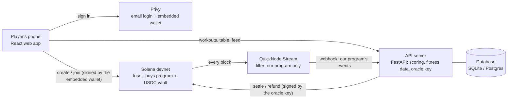

# Loser Buys

**Out-move your friends. Winner takes the pool.**

University Blockchain Conference Hackathon 2026. Track: Consumer Applications. Chain award: Solana. Bounties: QuickNode Streams, Gemini Prediction Markets.
Team: Yusuf Elloumi, Shaan Bhasin, Rohan Bhasin, Mahdi Khani.

A friend group starts a fitness challenge. Each person chips in a buy-in, workouts earn points, and at the end the pool is paid to whoever is top of the table. The pool is held and paid out by a program on Solana, so no friend has to hold the money and nobody can run off with it.

**Demo only: Solana devnet and test tokens. No real money.**

| | |
|---|---|
| Live app | Not deployed yet |
| Demo video | Not recorded yet |
| Program ID (devnet) | [`FeCj36zk7YNkdfKZXjfjSmftqpJv9C68uBNSvtRt3ssC`](https://explorer.solana.com/address/FeCj36zk7YNkdfKZXjfjSmftqpJv9C68uBNSvtRt3ssC?cluster=devnet) |

## What using it looks like

1. Sign in with an email code. There is no wallet to install, no seed phrase, and no fee to think about.
2. Tap "Add test funds" (this stands in for paying by card).
3. Start a challenge: name it, pick a buy-in, how long friends can join, and how long it runs. Share the invite link.
4. Friends open the link, agree to share their points with the group, and tap "Join for 1 USDC".
5. Log workouts. The league table shows each player's points and which days they were active.
6. When time is up, the program pays the pool to the top scorer. Ties split it. If fewer than two people joined, everyone is refunded.

Scoring ("Daily Mover"): 1 point for a day with at least 20 active minutes, plus 1 point for every 5 km that day, capped at 3 points a day.

## How it works



Three pieces are ours:

- **The pool program** (`onchain/`, Rust + Anchor). Holds each challenge's buy-ins in a token vault that only the program can spend from, and pays them out.
- **The API server** (`api/`, Python + FastAPI). Turns workouts into points, stores the league table, receives onchain events from the Stream, and holds the one key allowed to report results.
- **The web app** (`web/`, React + Vite + TypeScript). Everything the player sees.

Glossary for the crypto words used below:

- **Devnet**: Solana's free test network. Tokens there have no value.
- **USDC**: a token worth one dollar each. We use Circle's devnet test version.
- **Program**: Solana's name for a smart contract, code that runs on the blockchain.
- **Embedded wallet**: a wallet created for the user behind the scenes when they sign in, so they never handle keys.
- **Oracle**: a trusted reporter that brings outside facts (here, who won) onto the blockchain.

## How we use Solana

| Item | Value |
|---|---|
| Program ID (devnet) | `FeCj36zk7YNkdfKZXjfjSmftqpJv9C68uBNSvtRt3ssC` |
| Framework | Anchor 1.2.2 (Rust) |
| Token | Circle devnet USDC, an SPL token: `4zMMC9srt5Ri5X14GAgXhaHii3GnPAEERYPJgZJDncDU` |
| Source | `onchain/programs/loser_buys/` |
| Interface (IDL) | `onchain/idl/loser_buys.json` |

All the money logic is onchain. The server never holds player funds.

| Instruction | Who can call | What it does |
|---|---|---|
| `create_challenge` | Anyone | Creates a challenge and its empty vault. Stores the buy-in, token, start and end times, and the oracle's address |
| `join_challenge` | Any player, before the start time | Moves the buy-in from the player's token account into the vault and adds the player (up to 8) |
| `end_early` | Oracle only | Ends the challenge now. Used by the admin "End week now" button |
| `settle` | Oracle only, after the end time | Pays the vault to the winners, split equally, in the same transaction. Winners must be players. Records a hash of the score sheet |
| `refund` | Anyone | Returns every buy-in if fewer than 2 players joined by the start, or if the oracle has not settled within 72 hours of the end |

Each instruction emits an event (`ChallengeCreated`, `PlayerJoined`, `ChallengeEnded`, `ChallengeSettled`, `ChallengeRefunded`). Those events are what the QuickNode Stream delivers to our server.

**How crypto stays invisible.** Privy creates a Solana wallet when someone signs in with their email. Wallet popups are turned off; our own button says what will happen ("Join for 1 USDC"). The server quietly sends each new wallet a little devnet SOL for fees, so players never see a fee. Amounts are shown in dollars, and addresses appear only behind "details" links to Solana Explorer.

**Verified on devnet through the web app (Nov 14):**

| Case | Challenge | Result |
|---|---|---|
| Single winner | [`6xr7yYYL...TdsLt`](https://explorer.solana.com/address/6xr7yYYLKur31ZBnf4NnD7YrDVJoxYWax9zp6TiTdsLt?cluster=devnet) | Winner received the whole 2 USDC pool ([transaction](https://explorer.solana.com/tx/5f8z9XGtuQKUT8k2bwm3Cv8L45C4SACt3w4brSVS7jLU8XABhRcdtGdpXUSGwVDwENU8M37WGHXog7NJSYg1xhrL?cluster=devnet)) |
| Tie | [`9fXUkUsz...oRGep`](https://explorer.solana.com/address/9fXUkUszcHksGWTmDNht32cKSNCYRKXK3kEqDvcoRGep?cluster=devnet) | Both players received 1 USDC |
| Refund | [`JMjBkJYw...9Y2WD`](https://explorer.solana.com/address/JMjBkJYw2mopKmVdKHYacpoQa52jwfaCTxmb8j9Y2WD?cluster=devnet) | The only player got the buy-in back ([transaction](https://explorer.solana.com/tx/36dy95sK6bqvFBDP1jTbejNbSaZ4uuY3nARjj5at2KR1nELXCs9qeK4EUpzKr6fvywAy775MCHnfwytiLH74kPyU?cluster=devnet)) |

## How we use QuickNode Streams

Our server does not poll the blockchain to find out what happened. A QuickNode Stream pushes it.

| Setting | Value |
|---|---|
| Network | Solana Devnet |
| Dataset | Programs + Logs |
| Filter | `streams/filter.js` |
| Destination | Webhook: `POST /webhooks/quicknode` on our API |

**Filter logic.** Out of every transaction on devnet, the filter keeps only successful ones that invoked our program ID. For each it sends just the signature, slot, block time, and log lines. If a batch has nothing for us it returns `null`, and nothing is delivered. Test it locally with `node streams/test_filter.js`.

**What the server does with a delivery** (`api/events.py`):

1. Checks the HMAC-SHA256 signature made with the Stream's security token (headers `X-QN-Nonce`, `X-QN-Timestamp`, `X-QN-Signature`) and refuses old deliveries.
2. Decodes our program's events from the log lines using the program's IDL.
3. Stores them in `chain_events`, skipping any it already has, so a repeated delivery is harmless.
4. Updates the stored challenge when it ends, settles, or is refunded.

**Why Streams is a core data source.** Three things on the challenge screen come from Stream events:

- **"Deposit confirmed"** appears when the player's `PlayerJoined` event has been stored, not when the browser thinks the transaction went through.
- **The feed** ("Maya joined - pool is now 3 USDC", "Settled - Sam won 4 USDC") is built from the stored events.
- **The pool total** is re-read whenever a new event arrives, so every player's screen updates when anyone joins or the pool is paid out.

**Why Streams rather than polling.** The public devnet RPC rate-limits heavily, and polling would mean asking "anything new?" for every open challenge every few seconds. With a filtered Stream the server hears only about our program, within seconds, and does no work when nothing happens.

**One honest limit.** A Solana Stream cannot replay blocks it failed to deliver, and it pauses after repeated failures (for example when our server is off). So after each settlement or refund the server runs a small catch-up (`events.catch_up`) that fetches that challenge's recent transactions and stores any missed events through the same code path. The Stream is the normal source; the catch-up only fills gaps.

## How we use Gemini Prediction Markets

**The pick'em tiebreaker.** Fitness contests among friends tie often, and splitting the pool is a flat ending. So before kick-off each player may make one free pick: who wins a real upcoming game. If the challenge ends in a tie at the top, a tied player whose pick was right takes the pool instead of splitting it.

Gemini's public Prediction Markets API (`GET /v1/prediction-markets/events`, market data, no key) does three jobs (`api/pickem.py`):

| Job | What we read |
|---|---|
| Find games | Active Sports events with exactly two sides and a start time in the next 7 days |
| Show live odds | Each side's market price, shown as a chance (a price of 0.62 is shown as 62%) |
| Decide who was right | After the game, the contract Gemini settled with `resolutionSide: "yes"` is the winner |

Rules that keep it fair: one pick each, changeable until kick-off, hidden from other players until kick-off, and locked after. Points always come first; the pick only matters in a tie. If the game has not settled when the challenge ends, or the picks cannot separate the tied players, they split the pool as usual. The picks and their outcome are written into the score sheet whose hash goes onchain.

Picks are free and no trading happens: we read market data only. Nothing about our users, and no fitness data, is sent to Gemini. The server caches the game list for a minute, well inside Gemini's public rate limit.

## Trust and security

Fitness data lives off the blockchain, so something has to report who won. That is the **oracle**: a key held by our server, whose address is stored in each challenge. This is the main trust assumption, and we would rather state it than hide it.

| Question | Answer |
|---|---|
| Who can report results? | Only the oracle key stored in the challenge |
| What could a dishonest or hacked oracle do? | Name the wrong player as the winner |
| What can it not do? | Pay anyone outside the player list, take a cut, end a challenge without a visible `end_early` event, or trap the funds |
| What if the oracle disappears? | 72 hours after the end, anyone can call `refund` and every buy-in is returned |
| What makes cheating detectable? | `settle` stores the SHA-256 hash of the final score sheet. Players can fetch the sheet (`GET /challenges/{address}/score-sheet`) and check it against the chain, so published scores cannot be changed quietly afterwards |

Other measures:

- The server never trusts the browser about a challenge. Buy-in, dates, creator, and the player list are read from the chain.
- A challenge is only recorded if it names our oracle and the devnet USDC mint.
- The treasury key (test funds and fee money) and the oracle key are separate. Both live outside the repo.
- Login tokens from Privy are verified on every request (signature, expiry, issuer, audience).
- Anti-cheat in scoring: activities outside the challenge dates, duplicates, overlapping activities, and impossible speeds earn nothing, and points are capped per day.

What we would add before real money: a dispute window before payout, more than one signer on results, verified activity data, and an audit of the program.

## Fitness data and privacy

- Other players see your **name, points, and active days only**, and only after you tick "Share my challenge points with this group". Your activities are visible only to you.
- **No fitness data goes onchain.** The program receives winner addresses and a salted hash.
- Every data source sits behind one interface, `FitnessProvider` (`api/fitness/`). Today there are two: `mock` (demo data that looks like a watch recording) and `manual` (self-reported, labelled unverified). `FITNESS_PROVIDER` in `.env` picks one.
- **Strava is designed but not connected.** Creating a Strava API app needs a paid subscription, and Strava's API terms raise open questions for a shared leaderboard. `docs/STRAVA_FLOW.md` describes the intended integration and the rules it must keep (no Strava data to AI services, 7-day retention, delete on disconnect). Nothing outside `api/fitness/` would change.

## Run it locally

Works on macOS, Windows, and Linux. You need Git, Python 3.13, and Node 22. The program is already deployed on devnet, so you do not need Rust or Anchor to run the app.

**Teammates:** follow [`docs/SETUP.md`](docs/SETUP.md) instead. It walks through installing the tools on macOS and Windows, uses the shared team `.env` (no accounts of your own needed), and has a troubleshooting table.

Setting up your own separate copy needs free accounts at [Privy](https://privy.io) and [QuickNode](https://quicknode.com):

**1. Settings.** Copy `.env.example` to `.env` at the repo root and fill in:

| Name | Where it comes from |
|---|---|
| `PRIVY_APP_ID`, `PRIVY_APP_SECRET`, `VITE_PRIVY_APP_ID` | Your Privy app. Enable email login and Solana embedded wallets |
| `TREASURY_KEYPAIR_PATH` | A devnet keypair file holding some SOL ([faucet](https://faucet.solana.com)) and USDC ([faucet](https://faucet.circle.com)). It hands out fee money and test funds |
| `ORACLE_KEYPAIR_PATH`, `ORACLE_PUBLIC_KEY` | A second devnet keypair file with a little SOL, and its public address. It reports results |
| `QUICKNODE_STREAM_SECURITY_TOKEN` | From your Stream (step 4) |
| `ADMIN_EMAILS` | Emails allowed to use "End week now" |
| `TICK_SECRET` | Any long random string |

Keep keypair files outside the repo. Never commit `.env`. Leave `DATABASE_URL` empty to use a local SQLite file.

**2. API.**

macOS / Linux:

```bash
cd api
python3.13 -m venv .venv
.venv/bin/python -m pip install -r requirements.txt
.venv/bin/python -m uvicorn main:app --reload
```

Windows (PowerShell):

```powershell
cd api
py -3.13 -m venv .venv
.venv\Scripts\python.exe -m pip install -r requirements.txt
.venv\Scripts\python.exe -m uvicorn main:app --reload
```

**3. Web app** (same on every system, in a second terminal). The first `npm install` can take around 20 minutes.

```
cd web
npm install
npm run dev
```

Open http://localhost:5173. Use `localhost`: the embedded wallet only works there or over HTTPS.

**4. Stream.** Expose the API with a tunnel (`cloudflared tunnel --url http://localhost:8000`). In QuickNode, create a Stream: network Solana Devnet, dataset Programs + Logs, paste `streams/filter.js` as the filter, destination webhook `https://<tunnel address>/webhooks/quicknode`. Copy its security token into `.env` and restart the API.

**5. Try it alone.** Create a challenge in the app and join it. For a second player, sign in with a different email in a private/incognito window. On Windows with the WSL toolchain set up ([`docs/SETUP.md`](docs/SETUP.md), Part 2), a test wallet can also join from the command line:

```
wsl -d Ubuntu -- bash -l scripts/wsl_anchor.sh join <challenge address>
```

## Tests

| What | Command | Where |
|---|---|---|
| API (87 tests: login, webhook, scoring, anti-cheat, settlement, pick'em) | Windows: `.venv\Scripts\python.exe -m pytest`<br/>macOS / Linux: `.venv/bin/python -m pytest` | `api/` |
| Program (11 tests on a local validator) | `anchor test --validator legacy` | `onchain/` |
| Program from Windows | `wsl -d Ubuntu -- bash -l scripts/wsl_anchor.sh test --validator legacy` | repo root |
| Stream filter | `node streams/test_filter.js` | repo root |
| Web type-check and build | `npm run build` | `web/` |

The program tests need Rust, the Solana CLI, Anchor 1.2.2, Node 22, and Yarn, on Linux, macOS, or WSL2. Install steps are in [`docs/SETUP.md`](docs/SETUP.md), Part 2.

## Repo layout

```
onchain/            Anchor workspace: the loser_buys program (Rust), its tests, devnet scripts, built IDL
web/                React + Vite web app
api/                FastAPI server
  fitness/          FitnessProvider interface with the mock and manual sources
  scoring.py        Daily Mover rules and anti-cheat (pure functions)
  settlement.py     final scores, winners, score-sheet hash, settle and refund
  events.py         QuickNode webhook: signature check, event decoding, feed
  pickem.py         pick'em tiebreaker on Gemini Prediction Markets data
  chain.py          talks to the program as the oracle
streams/filter.js   the QuickNode Stream filter
scripts/            WSL helper for Anchor, plan PDF builder
docs/               SETUP.md (teammate setup, macOS and Windows), ARCHITECTURE.md, STRAVA_FLOW.md, HACKATHON_GUIDE.md
```

## Known limits

- Devnet only, by design. The app and the server refuse any non-devnet RPC address.
- Workouts are demo data or self-reported until a verified source such as Strava is connected.
- One scoring template.
- The 72-hour refund timeout is in the program but is not covered by an automated test, because the local test validator's clock cannot be moved forward.
- Results depend on one oracle key (see "Trust and security").

Built during the hackathon (started Nov 12, 2026), with AI coding tools.
