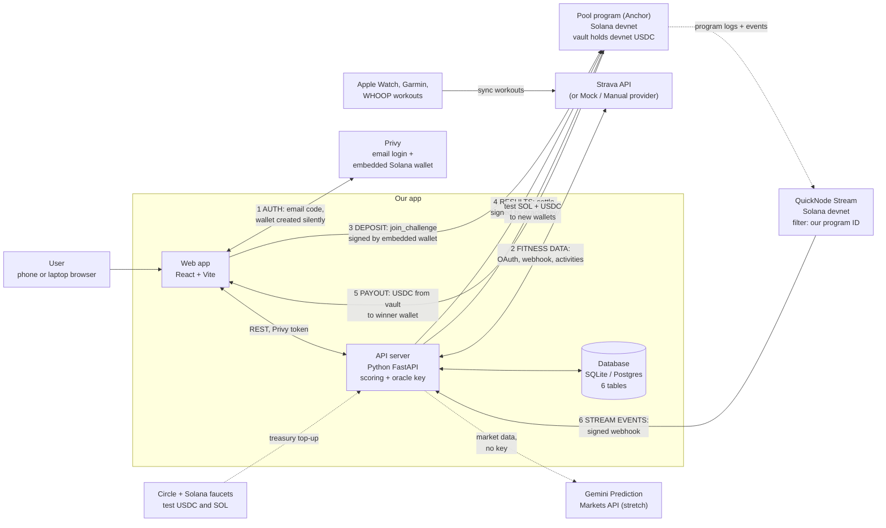

# Architecture and Integration Guide - Loser Buys

Written Saturday, November 14, 2026, before any code. Facts marked **(verified)** were read from official documentation on that date; links are in [Sources](#sources). Items marked **(assumption)** or **(confirm)** have not been verified.

Contents: [Map](#1-architecture-map) | [Integration table](#2-integration-table) | [Walkthrough](#3-end-to-end-walkthrough) | [Results, settlement, trust](#4-results-settlement-and-trust) | [Strava](#5-strava-what-we-can-and-cannot-do) | [Wallets](#6-embedded-wallet-vs-connect-wallet) | [Prediction markets](#7-prediction-market-assessment) | [Legal](#8-legal-and-regulatory-flags) | [Sources](#sources)

## 1. Architecture map

Three pieces are ours: the **web app** (what users see), the **API server** (scores, Strava, and the one key allowed to report results), and the **pool program** on Solana (holds the money and pays the winner). Everything else is an outside service.

What each numbered flow does:

| # | Flow | In plain words |
|---|---|---|
| 1 | Authentication and wallet | The user types an email and a 6-digit code. Privy creates a Solana wallet for them behind the scenes. The web app sends Privy's login token to our API, which checks it. |
| 2 | Fitness data | The user taps "Connect with Strava" once. After that Strava tells our API whenever they finish an activity, and the API fetches it and turns it into points. A mock or manual provider can replace Strava without touching anything else. |
| 3 | Deposit | The user taps "Join for 1 USDC". The embedded wallet signs a `join_challenge` transaction that moves their USDC into a vault that only the program controls. |
| 4 | Results | When the week ends, the API works out the winner and sends `settle` to the program, signed with the oracle key. |
| 5 | Payout | Inside that same `settle` transaction the program sends the vault's USDC to the winner (or splits it between tied winners). No one has to "claim". |
| 6 | QuickNode Streams events | A Stream watches Solana devnet, keeps only transactions that touch our program, and posts them to our API. This is how the app knows a deposit landed or a payout happened, and it powers the live feed. |

## 2. Integration table

| Platform | Purpose | API / SDK | How it connects | Access requirements | Cost | Limitations | Prize |
|---|---|---|---|---|---|---|---|
| **Solana devnet + Anchor** | Prize pool program: holds buy-ins, pays winners | Anchor (docs show 1.2.2), Solana CLI; TS client `@anchor-lang/core`; Python `solders`/`solana-py` **(confirm in Stage 1)** | Web app sends `create`/`join`; API sends `settle`/`end_early`; anyone can send `refund` | WSL2 on Windows **(verified: required)**; devnet SOL from faucet | Free | Faucet limits (web faucet: 2 requests per 8 h); devnet can be reset or slow; TS client only works with `@solana/web3.js` v1 **(verified)** | Solana award, Consumer |
| **Devnet USDC (Circle)** | The token in the pool | SPL token, mint `4zMMC9srt5Ri5X14GAgXhaHii3GnPAEERYPJgZJDncDU` **(verified)** | Treasury wallet collects from Circle faucet and hands small amounts to new users | None, no account | Free | 20 USDC per 2 h per address **(verified)**; keep buy-ins at about 1 USDC; fallback is our own test token | Solana award |
| **Privy** | Email login and embedded Solana wallet | `@privy-io/react-auth` (+ `/solana`), JWT check on the server | React provider in the web app; API verifies the ES256 access token | Free Developer plan: under 500 monthly users, 50K signatures **(verified)** | Free at our size. **Native gas sponsorship uses prepaid credits and needs TEE mode - may cost money (confirm)**; we avoid it with a gas drip | Auto wallet creation only via Privy's login modal, not custom code forms **(verified)**; no Python token-verify helper found | Consumer |
| **QuickNode Streams** | Push onchain events to our server | Streams dashboard or REST API; JS filter; webhook destination | Stream (Solana Devnet, "Programs + Logs") -> filter by our program ID -> `POST /webhooks/quicknode` with HMAC check | Free trial account **(confirm devnet on free plan and whether a card is needed)** | Free trial: 10M credits, 1 Stream, includes 1 month **(verified from pricing page)** | Free plan: 1 Stream, chain tip only, no Solana backfill, no reorg handling; Stream pauses after 3 failed deliveries **(verified)** | QuickNode bounty |
| **Strava API** | Verified activity data | REST v3, OAuth2 (`activity:read`), one webhook subscription | API server only, behind the `FitnessProvider` interface | **A Strava subscription is required to create an app (verified) - costs money unless someone already subscribes**; new apps hold 1 athlete, raise to 10 from the dashboard without review **(verified)** | API itself is free; the subscription is not | Activities only (no steps, sleep, recovery); strict rules on showing data to others, 7-day cache, no AI use (see section 5); 200 requests/15 min, 2,000/day | Consumer (daily use) |
| **Mock / Manual provider** | Stand-in for Strava; demo and tests | Our own code | Same interface as Strava | None | Free | Not verified data; labelled as such in the UI | Consumer |
| **Gemini Prediction Markets** (stretch) | Weekly pick'em tiebreaker | REST `GET /v1/prediction-markets/events`, public, no key **(verified)** | API server proxies and caches market data | None for market data; trading needs an account, API key, and terms acceptance | Free | Cannot create custom markets; 120 public requests/min; browser (CORS) access not documented | Gemini bounty |
| **Grok Bot** (optional) | xAI's assistant inside X; could watch our program's onchain events and post a group recap | Grok Bot on X **(capabilities to confirm by testing)** | Reads public onchain events only; must never receive fitness data | X Premium (organizers provide redemption links) | Free via the hackathon perk **(confirm)** | Strava policy forbids sending its data to AI; unclear whether it can read Solana devnet | Grok bounty |
| **Vercel** | Host the web app | Git deploy | Static React build | Free Hobby plan | Free | Hobby plan is for non-commercial use | Submission (deployed app) |
| **Render + Neon** | Host the API and database | Git deploy; Postgres URL | FastAPI web service; `DATABASE_URL` switches SQLite to Postgres | Free plans **(confirm current limits)** | Free | Free web services sleep when idle and lose local files, which is why the deployed database is Neon, not a SQLite file; a sleeping server can pause the Stream | Submission (deployed app) |

## 3. End-to-end walkthrough

1. **Register.** Maya opens the app and enters her email and the code she is sent. Privy creates her Solana wallet. Our API saves her user row and quietly sends her wallet a little devnet SOL so fees never appear ("gas drip").
2. **Add test funds.** Maya taps "Add test funds" and the treasury sends her 5 devnet USDC. In a real product this would be a card on-ramp.
3. **Create a group challenge.** Maya picks the "Daily Mover" template, a 1 USDC buy-in, and a start and end date. The web app sends `create_challenge`; the program creates the challenge and its vault. She shares the invite link.
4. **Join and deposit.** Sam opens the link, signs up the same way, ticks "Share my challenge points with this group", and taps "Join for 1 USDC". His embedded wallet signs `join_challenge`. The QuickNode Stream sees the transaction, posts it to our API, and both phones show "Sam joined - pool is 2 USDC". Joining closes at the start time.
5. **Connect fitness data.** Each player connects Strava once (or uses the mock/manual provider).
6. **Complete challenges daily.** Sam records a run on his watch. It syncs to Strava. Strava's webhook tells our API; the API fetches the activity, applies the rules, and stores points for that day.
7. **Scores update.** The leaderboard shows each player's points and daily ticks. Only points are shown to the group; activity details are visible only to their owner.
8. **Week ends.** At the end time (or when an admin taps "End week now"), the API waits for the grace period, pulls any late activities, finalizes scores, and sends `settle` with the winner list and a hash of the score sheet.
9. **Payout.** The program checks the caller is the oracle, the end time has passed, and every winner is a player, then sends the vault's USDC to the winner. The Stream delivers the `ChallengeSettled` event and the app shows "Maya won 2 USDC" with a link to the transaction.

### Edge cases

| Situation | Rule |
|---|---|
| **Tie** | Tied players split the pool equally; any leftover fraction goes to the first listed winner. With the optional Gemini pick'em on, a correct pick breaks the tie first. |
| **Missing or delayed data** | Scores are not final until a grace period after the end time (12 hours by default, zero for demos). Before finalizing, the API re-fetches each player's activities for the week in case a webhook was missed. If Strava is down, the API waits rather than settling on partial data. |
| **Oracle never settles** | 72 hours after the end time anyone can call `refund` and every buy-in is returned. Funds cannot be stuck. |
| **Not enough players** | If fewer than 2 players joined by the start time, `refund` returns the buy-ins. |
| **Dropping out mid-week** | Buy-ins are locked once the week starts. A player who stops simply stops scoring and can still lose. Leaving before the start with a refund is a later feature. |
| **Disconnecting Strava mid-week** | We must delete their Strava data, so their score becomes zero and they stay in the pool. The join screen says so. |
| **Cheating: fake manual entries** | Strava marks hand-typed activities with `manual: true`; these earn no points. Activities need a recording device name. |
| **Cheating: implausible data** | Points are capped per day; impossible speeds and overlapping or duplicate activities are rejected; only activities that start inside the challenge window count. |
| **Cheating we cannot stop** | Someone else wearing the watch, an e-bike logged as a run, a spoofed GPS file. Among friends the main protection is social. A later version could add a group veto during a dispute window. |

## 4. Results, settlement, and trust

**How results get onchain.** Fitness data lives off the blockchain, so something has to carry the result across. That something is our API server holding an **oracle key**. The program stores the oracle's address when a challenge is created and only accepts `settle` from it.

**What triggers settlement.** (a) A timer: a scheduled call to `/internal/tick` settles any challenge past its end time plus the grace period. (b) The admin "End week now" button, which sends `end_early` and then `settle`, for demos and testing on devnet.

**Who is trusted for what:**

| Question | Answer |
|---|---|
| Who can submit results? | Only the oracle key stored in the challenge account. |
| What stops the oracle from lying? | Nothing cryptographic. This is the main trust assumption, and the README must say so. |
| What can a dishonest or hacked oracle do? | Name the wrong player as winner. |
| What can it not do? | Send funds to an outsider (winners must be in the player list), take a cut, settle before the end time without the visible `end_early` event, or trap funds (the refund timeout). |
| What makes lying detectable? | `settle` records a hash of the final score sheet, so the published scores cannot be quietly changed afterwards, and every settlement is a public transaction. |
| Who else is trusted? | Strava and the watch for the data; Privy for wallet custody; our server not to leak the oracle key. |
| What would we add later? | A 24-hour dispute window before payout, two-of-three signers (or a group vote) on results, and an independent data attestation service. |

The treasury key (test funds) and the oracle key are separate so that leaking one does not expose the other. Both live only in `.env` / host secrets.

## 5. Strava: what we can and cannot do

### What data is reachable

| Source | Reaches Strava? | What we get |
|---|---|---|
| Garmin | Yes, automatic sync from Garmin Connect **(assumption, well known)** | Recorded workouts |
| Apple Watch | Yes, via the Strava watch app or Apple Health sync **(assumption)** | Workouts only |
| WHOOP | Workouts can be shared to Strava **(assumption)** | Activities only; no strain, recovery, or sleep |

Activity fields **(verified in the API reference)**: `sport_type`, `distance`, `moving_time`, `elapsed_time`, `start_date`, `total_elevation_gain`, `calories`, `device_name`, `manual`, `trainer`, `has_heartrate`. Heart-rate averages were not confirmed.

**Not available through Strava:** daily steps, sleep, HRV, resting heart rate, recovery or strain scores, nutrition, habits such as meditation. For those we would need a different integration: the WHOOP API, Garmin's Health API (business approval), Apple HealthKit (needs a native iOS app, which is out of scope), or a paid aggregator such as Terra. **For the hackathon, challenges are limited to recorded workouts** (active minutes, distance, number of active days). Other habits could use the manual provider, labelled unverified.

### Access limits (verified)

- Creating an API app requires a Strava subscription.
- A new app can hold 1 athlete ("single-player mode"); the developer can raise it to 10 from the API settings page without review. Beyond 10 needs a review with no promised timeline. Ten is enough for a demo.
- Rate limits: 200 requests per 15 minutes and 2,000 per day by default.
- One webhook subscription per app; our endpoint must answer within 2 seconds.
- Access tokens last 6 hours and are refreshed with a refresh token.

### API Agreement and API Policy (effective June 1, 2026)

| Rule | What it says | Effect on us |
|---|---|---|
| Display limited to the user (Policy 2.3) | A user's Strava data may be shown "only to that user"; other users' data may not be displayed even if public on Strava | A leaderboard of raw Strava activities is **not allowed** |
| Consent (Policy 5.13; Agreement highlights) | Do not let others see a user's data "without the prior express consent of that user" | Our basis for a consent-based points leaderboard. **This is our reading, not confirmed by Strava** |
| Small apps (Policy 6.1) | A sentence ties the own-data-only limit to apps with capacity above 9,999; the wording is ambiguous | Do not rely on it |
| No AI (Policy 5.3, 5.5, 5.10) | No training, prompts, embeddings, retrieval, or context-window use of Strava data; no sharing with AI providers even with consent | **No Strava data may go to Grok or any LLM**, including derived or anonymized data |
| Cache (Policy 6.2) | Keep Strava data no longer than 7 days | Store points and activity IDs, not raw activities; purge on a schedule |
| Deletion (Policy 6.3, 7.4) | Reflect deletions within 48 hours; delete a user's data, including derived personal data, within 30 days of them disconnecting | Disconnect wipes their activity data and scores |
| Competing (Policy 5.2) | No use "competitive to Strava" | Strava has its own challenges and leaderboards. **Unclear risk - ask Strava** |
| Fees (Policy 5.8) | Limits on charging end users for functionality tied to Strava | We take no fee; the buy-in goes to the winner. **Ask Strava whether pooled buy-ins are a problem** |
| Gambling or prizes | Nothing found in either document | Not a green light; just silent |
| Branding | "Connect with Strava" button, "Powered by Strava", "View on Strava" links; no "Strava" in our app name | Follow the brand guidelines |

### How the friend leaderboard complies

1. **Explicit opt-in.** Before joining a challenge each user ticks "Share my challenge points with the members of this group". No consent, no joining. Consent time is stored.
2. **Points, not activities.** Other members see only a display name, a points total, and daily ticks computed by our rules. They never see distance, pace, maps, times, heart rate, or activity titles.
3. **Owner-only detail.** Activity details appear only in the owner's own "My activity" view, with "View on Strava" links.
4. **Nothing personal onchain.** A blockchain is public and permanent. The program receives only the winner's wallet address and a salted hash of the score sheet.
5. **Short retention.** Raw activity payloads are not stored beyond what scoring needs and are purged within 7 days. Disconnecting deletes the user's data and zeroes their score.
6. **No AI.** No Strava-derived value is sent to any AI service.
7. **Small scale.** At most 10 connected athletes.

**Honest residual risk:** Strava could say that computed points are still "Strava Data" and that section 2.3 forbids any cross-user display regardless of consent. We cannot get a ruling before Friday. So: the demo defaults to the mock provider, live Strava is connected only for team members' own accounts, and the README states our reading and the open question. If Strava is blocked (no subscription, no approval, or terms), we demo the intended flow from `docs/STRAVA_FLOW.md` and explain why.

## 6. Embedded wallet vs. connect-wallet

| | Embedded wallet (recommended) | Connect an existing wallet |
|---|---|---|
| Sign-up | Email and a code | Install a wallet app, save a seed phrase, approve a connection |
| Fits "crypto is invisible" | Yes: no seed phrase, no popups, fees hidden | No: every step shows crypto |
| Friends who have never used crypto | Works | Most will drop off |
| Mobile browser | Works in any browser | Needs the wallet's in-app browser or deep links |
| Cost and effort | One SDK; free at our size | Free; less code |
| Downsides | We depend on Privy; users rely on Privy's key management | Excludes most of our target users |

**Recommendation: embedded wallets through Privy, email login only.** The Consumer track explicitly rewards no seed phrases and no gas confusion, and our users are friend groups, not crypto users. Optional later: let crypto-native users link an external wallet too.

**Hiding fees.** Three options, in order of effort:

1. **Gas drip (plan A).** The server sends each new wallet a tiny amount of devnet SOL. Thirty minutes of work, no extra SDK features.
2. **Privy native sponsorship.** One flag (`sponsor: true`), but requires TEE execution, a dashboard setting, and prepaid credits; whether devnet is free is unconfirmed.
3. **Our own fee payer.** The server co-signs every transaction as fee payer. Most code, most control. This is what a production app would use.

## 7. Prediction-market assessment

### Where prediction markets could add value

The fun version is obvious: friends who are not competing this week back whoever they think will win, which gives spectators a reason to open the app daily.

### What we could build ourselves onchain

| Feature | How | Verdict |
|---|---|---|
| "Back a friend" side pool | A second vault per challenge; spectators deposit on a participant; when `settle` runs, backers of the winner split the side pool pro rata | Technically a modest extension of our program (about a day). **Not for the hackathon:** it turns a self-improvement contest into betting on other people, which is the legally riskiest thing we could add (section 8), and it adds incentive to cheat |
| Free "pick the winner" predictions | Same idea with points instead of money, stored in our database | Safe and fun; a later addition |

### What Gemini's API actually supports (verified)

- Public, no key: list events, get one event, categories, newly listed, upcoming, recently settled, volume. Each event has contracts with yes/no prices.
- Categories shown in the docs: sports, politics, crypto, entertainment. The sports list includes "athletics" among about 20 sports.
- With an account and API key: place and cancel orders, view positions, after accepting terms. A sandbox with test funds exists; whether prediction markets are enabled there is not stated.

**Can we create custom fitness markets on Gemini? No.** The documented API has no endpoint to create an event or market. The only "create" call builds a combo from existing contracts. A market like "Will Sam run 20 km this week?" cannot be listed on Gemini. Gemini markets are about public real-world events.

### The most natural Gemini feature

**Weekly pick'em tiebreaker.** When creating a challenge, the group can switch on "Pick'em". The app shows a few live sports events from Gemini with the market's current odds. Each member makes one free pick before the week starts. If the fitness contest ends in a tie, the member whose pick was right wins; if still tied, they split.

- Uses Gemini for something real: event discovery, live prices, and settlement results.
- Server-side only, public endpoints, no key, no trading, no cost. About 3-4 hours.

### Is it worth building?

**Honestly: only if the core app is finished by Wednesday night, but it is the first stretch item to build.**

- **It qualifies.** The hackathon guide requires the "Gemini Prediction Markets API (market data and/or trading endpoints)", and one stated objective is to "bring prediction market data into other apps, such as news, social, or onchain applications". A pick'em inside a social app matches that.
- **The prize is large.** $2,500 / $1,000 / $500 with three places, more than the QuickNode bounty, and first place gets a finalist pitch slot.
- **The odds are modest.** The feature is adjacent to our product rather than central to it, and other teams will build whole projects around Gemini (analytics, trading bots). Third place is a realistic best case.
- **It adds a little chance** to a contest we otherwise describe as pure skill, which is why it is opt-in and only a tiebreaker.

Ask Gemini at office hours what would make this entry stronger before spending time on it.

## 8. Legal and regulatory flags

This is not legal advice. It is a list of things a lawyer would need to look at before any real-money launch.

| Concern | Why it matters |
|---|---|
| Gambling law | Paying to enter a contest with a cash prize can be gambling depending on the state or country. Many places allow "skill contests", but definitions differ, some US states restrict paid-entry skill games, and fantasy-sports exemptions do not obviously cover betting on yourself |
| Money transmission | If we, or a key we control, can direct users' money, regulators may treat us as a money transmitter (registration, licences, KYC/AML). A program-held vault helps, but our oracle key decides who gets paid |
| Taking a fee | A cut of the pool increases both of the risks above. The MVP takes none |
| Side bets on friends | Betting on someone else's result looks like sports betting or an unregistered event contract. Much higher risk than self-backed pools |
| Chance elements | A pick'em tiebreaker adds chance. Keep it optional and free |
| Age and location | Real money would need 18+ checks and location restrictions |
| Disputes and fraud | Health data can be faked; with real money that becomes fraud and a consumer-protection issue |
| Health and privacy | Fitness data is sensitive personal data (GDPR, state privacy laws). Collect little, keep it briefly, never put it onchain |
| Platform terms | Strava's terms (section 5) and, for a future native app, app-store rules on real-money contests |

**Confirmed: the demo uses devnet tokens only.** Devnet SOL and devnet USDC are free test tokens with no value, so no real money moves and none of the above is triggered by the hackathon build. The UI and README should say "Demo - test tokens only, no real money". Mainnet is out of scope.

## Sources

Official documentation read on 2026-11-14:

- Strava API Agreement (effective June 1, 2026): https://www.strava.com/legal/api
- Strava API Policy (effective June 1, 2026): https://www.strava.com/legal/api_policy
- Strava brand guidelines: https://developers.strava.com/guidelines/
- Strava getting started (subscription, athlete capacity): https://developers.strava.com/docs/getting-started/
- Strava rate limits: https://developers.strava.com/docs/rate-limits/
- Strava authentication: https://developers.strava.com/docs/authentication/
- Strava webhooks: https://developers.strava.com/docs/webhooks/
- Strava API reference: https://developers.strava.com/docs/reference/
- Strava changelog: https://developers.strava.com/docs/changelog/
- QuickNode Streams overview: https://www.quicknode.com/docs/streams
- QuickNode supported chains: https://www.quicknode.com/docs/streams/supported-chains
- QuickNode filters: https://www.quicknode.com/docs/streams/filters
- QuickNode webhook destination: https://www.quicknode.com/docs/streams/destinations/webhooks
- QuickNode webhook signature guide: https://www.quicknode.com/guides/quicknode-products/streams/validating-incoming-streams-webhook-messages
- QuickNode Solana program data guide: https://www.quicknode.com/guides/quicknode-products/streams/how-to-stream-solana-program-data
- QuickNode Streams REST API: https://www.quicknode.com/docs/streams/rest-api
- QuickNode pricing: https://www.quicknode.com/pricing
- Gemini Prediction Markets spec: https://developer.gemini.com/prediction-markets-spec
- Gemini Prediction Markets REST: https://developer.gemini.com/rest-api/prediction-markets.md
- Gemini market data: https://developer.gemini.com/prediction-markets/market-data.md
- Gemini sandbox: https://developer.gemini.com/get-started/sandbox
- Gemini rate limits: https://developer.gemini.com/rate-limit
- Privy automatic wallet creation: https://docs.privy.io/basics/react/advanced/automatic-wallet-creation.md
- Privy Solana transactions: https://docs.privy.io/wallets/using-wallets/solana/send-a-transaction.md
- Privy gas sponsorship: https://docs.privy.io/wallets/gas-and-asset-management/gas/overview.md and https://docs.privy.io/wallets/gas-and-asset-management/gas/solana.md
- Privy wallet UI settings: https://docs.privy.io/recipes/react/manage-wallet-UIs.md
- Privy tokens: https://docs.privy.io/authentication/user-authentication/tokens.md
- Privy pricing: https://privy.io/pricing
- Anchor installation: https://www.anchor-lang.com/docs/installation
- Anchor TypeScript client: https://www.anchor-lang.com/docs/clients/typescript
- Anchor + Solana Playground: https://www.anchor-lang.com/docs/quickstart/solpg
- Circle USDC addresses: https://developers.circle.com/stablecoins/usdc-contract-addresses
- Circle faucet: https://faucet.circle.com/
- Solana faucet: https://faucet.solana.com/

Third-party, used only as a pointer (not relied on): https://tryterra.co/blog/strava-api-changes-2026

Not verified from official sources: device sync behaviour for Apple Watch, Garmin, and WHOOP; Render, Neon, and Vercel free-plan limits; Python Solana client compatibility with the current Anchor; the cost in SOL of deploying a program; everything about Grok Bot. The Solana install page (solana.com) could not be loaded, so install steps come from Anchor's page.
